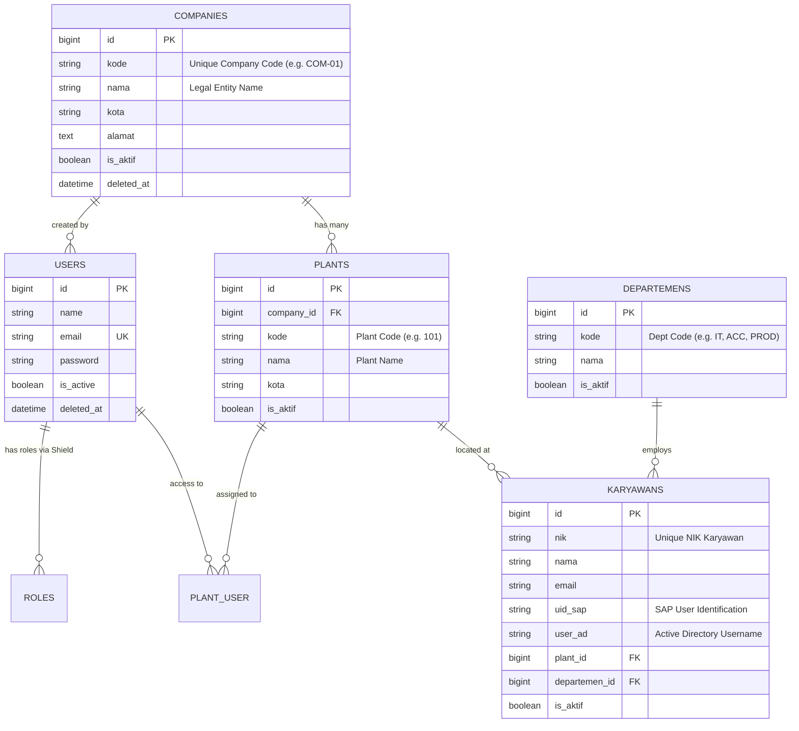

# 🏢 Modul 01: Multi-Company, Plant & User Access Control (RBAC)

> **Status Modul:** `Production / Stable`  
> **Diperkenalkan Sejak:** `v0.1.0` (18 Juli 2024)  
> **Pembaruan Terakhir:** `v0.5.0` (27 Agustus 2025)  
> **Ruang Lingkup:** Master Organisasi, Data Karyawan, Autentikasi & Otorisasi

---

## 🕒 Jejak Evolusi Modul (Module Version History)

- **v0.1.0 (2024-07-18):**
  - Inisiasi awal tabel master struktur organisasi: `companies`, `plants`, `departemens`, dan `karyawans`.
  - Integrasi otentikasi pengguna (`users`) dengan `spatie/laravel-permission` melalui plugin `bezhan-salleh/filament-shield`.
  - Pembuatan tabel pivot `plant_user` untuk memetakan penugasan user ke satu atau lebih pabrik (multi-plant authorization).
- **v0.5.0 (2025-08-27):**
  - Penguatan isolasi data operasional: standarisasi kolom `plant_id` pada transaksi (Stok, Mutasi, dan Tiket) agar mengacu secara ketat ke tabel `plants`.

---

## 🎯 1. Ringkasan Bisnis & Use Case

Sistem dirancang untuk mendukung operasional perusahaan manufaktur dengan struktur multi-entitas (*holding/subsidiaries*) dan banyak lokasi pabrik (*multi-plant*). Modul ini berfungsi sebagai penyedia data identitas sentral bagi seluruh modul transaksi:

1. **Hierarki Entitas Bisnis:** Menghubungkan PT (Company) ke beberapa pabrik atau kantor perwakilan (Plant), lalu ke divisi fungsional (Departemen).
2. **Master Karyawan :** Menyimpan profil karyawan lengkap (NIK, nama, departemen, plant, jabatan, email, User AD, dan UID SAP) yang akan bertindak sebagai peminjam perangkat, pelapor tiket servis, pengaju nomor aset, atau pembuat klaim.
3. **Role-Based Access Control (RBAC):** Menjamin bahwa setiap pengguna (User) hanya memiliki hak akses baca/tulis (*view, create, update, delete, restore*) sesuai peran mereka di plant terkait.

---

## 🗄️ 2. Skema Basis Data & Relasi (ERD)



### Tabel & Indeks Kunci:
1. **`companies`**: Induk legalitas. Dilengkapi soft deletes (`deleted_at`).
2. **`plants`**: Unit cabang. Berelasi ke `companies` (`company_id` foreign key).
3. **`departemens`**: Satuan divisi kerja.
4. **`karyawans`**: Profil karyawan, memiliki indeks NIK unik dan relasi wajib ke `plant_id` dan `departemen_id`.
5. **`plant_user`**: Tabel perantara many-to-many (`user_id`, `plant_id`) untuk mengontrol hak akses operasional multi-cabang.
6. **`roles` & `permissions`**: Standar Spatie Permission yang diatur melalui antarmuka Filament Shield.

---

## 💻 3. Implementasi Model Eloquent & Logika Bisnis

### Model [`Company`](file:///home/netcom/apps/app/Models/Company.php)
- Memiliki relasi `plants()` (`HasMany`).
- Menggunakan trait `SoftDeletes`.

### Model [`Plant`](file:///home/netcom/apps/app/Models/Plant.php)
- Relasi `company()`: `belongsTo(Company::class)`.
- Relasi `users()`: `belongsToMany(User::class)` melalui tabel pivot `plant_user`.
- Relasi `karyawans()`: `hasMany(Karyawan::class)`.

### Model [`Karyawan`](file:///home/netcom/apps/app/Models/Karyawan.php)
- Menggunakan global scope atau filter status aktif (`is_aktif = 1`).
- Mengisolasi data karyawan per lokasi:
```php
public function plant(): BelongsTo
{
    return $this->belongsTo(Plant::class);
}

public function departemen(): BelongsTo
{
    return $this->belongsTo(Departemen::class);
}
```

### Model [`User`](file:///home/netcom/apps/app/Models/User.php)
- Mengimplementasikan antarmuka `FilamentUser` dan `HasAvatar`.
- Menggunakan traits: `HasRoles`, `HasPanelShield`, `HasApiTokens`, `SoftDeletes`.
- Relasi `plants()`: `belongsToMany(Plant::class)` untuk membatasi kueri panel hanya pada plant yang ditugaskan ke user tersebut.

---

## 🖥️ 4. Antarmuka Pengguna & Filament Resources

| Resource Class | Navigasi Panel | Fitur Utama |
| :--- | :--- | :--- |
| [`CompanyResource.php`](file:///home/netcom/apps/app/Filament/Resources/CompanyResource.php) | *Plants Cluster* | CRUD Legal Entity, status aktif/non-aktif, kode unik perusahaan |
| [`PlantResource.php`](file:///home/netcom/apps/app/Filament/Resources/PlantResource.php) | *Plants Cluster* | Manajemen lokasi pabrik, pemetaan ke Company, ekspor data plant |
| [`DepartemenResource.php`](file:///home/netcom/apps/app/Filament/Resources/DepartemenResource.php) | *Master Group* | Master divisi operasional, relasi sub-departemen hirarkis |
| [`KaryawanResource.php`](file:///home/netcom/apps/app/Filament/Resources/KaryawanResource.php) | *Master Group* | Pencatatan NIK, foto profil, mapping UID SAP / Active Directory, ekspor Excel (`KaryawanExport`) |
| [`UserResource.php`](file:///home/netcom/apps/app/Filament/Resources/UserResource.php) | *Setting Group* | Manajemen akun login, aktivasi user, penugasan multi-plant, dan assign Role Shield |

---

## 🔒 5. Kontrol Akses & Keamanan (Filament Shield)

1. **Role Shield Standar:**
   - `super_admin`: Memiliki akses penuh (*bypass all permissions*) ke semua data, company, plant, dan pengaturan sistem.
   - `admin_plant`: Dibatasi untuk mengelola data master dan transaksi pada plant yang terdaftar di akunnya.
   - `approver`: Memiliki hak verifikasi dan otorisasi dokumen (klaim, pengajuan nomor aset).
   - `user / staff`: Memiliki hak membuat draf permohonan (*create*) dan melihat status tiket miliknya.
2. **Permission Guard:** Seluruh resource mengimplementasikan interface `HasShieldPermissions` yang secara otomatis menghasilkan permissions granular:
   - `view_company`, `create_company`, `update_company`, `delete_company`
   - `view_plant`, `create_plant`, `update_plant`, `delete_plant`
   - `view_karyawan`, `create_karyawan`, `update_karyawan`, `delete_karyawan`

---

## 🛠️ 6. Troubleshooting & Best Practices

| Masalah yang Sering Muncul | Penyebab Teknis | Solusi / Cara Mengatasi |
| :--- | :--- | :--- |
| Karyawan tidak muncul di dropdown saat membuat tiket/klaim | Kolom `is_aktif` pada record karyawan bernilai `false` (0) | Pastikan status karyawan diaktifkan melalui menu `KaryawanResource`. |
| User baru tidak bisa melihat data transaksi plant tertentu | Record relasi di tabel pivot `plant_user` belum ditambahkan | Buka `UserResource`, pilih tab/field **Plants**, centang lokasi plant yang diizinkan untuk user tersebut. |
| Error `Select::isOptionDisabled(): Argument #2 ($label) must be string, null given` | Ada record `plant` atau `company` dengan nama `NULL` di database | Selalu sediakan fallback label saat mapping options: `$plant->nama ?? 'Tanpa Nama'`. |
