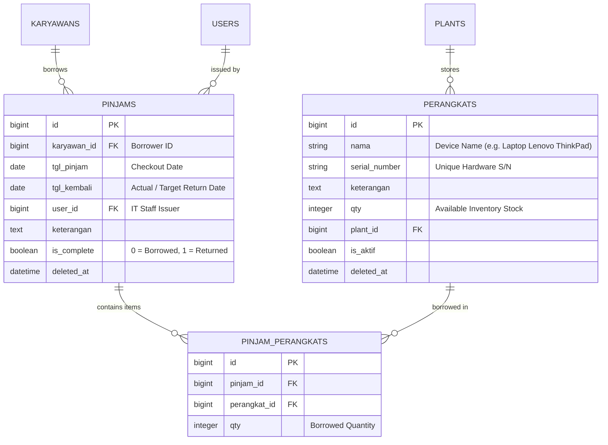

# 💻 Modul 02: Inventaris Perangkat IT & Sirkulasi Peminjaman

> **Status Modul:** `Production / Stable`  
> **Diperkenalkan Sejak:** `v0.1.0` (18 Juli 2024)  
> **Pembaruan Terakhir:** `v0.6.0` (20 Agustus 2026)  
> **Ruang Lingkup:** Master Hardware IT Operasional, Form Sirkulasi Peminjaman, Multi-Item Pivot, Email Notifikasi Otomatis

---

## 🕒 Jejak Evolusi Modul (Module Version History)

- **v0.1.0 (2024-07-18):**
  - Pembuatan tabel `perangkats` untuk mendata hardware siap pinjam (Laptop, Scanner, Proyektor, Barcode Reader).
  - Pembuatan transaksi peminjaman `pinjams` dan tabel pivot detail `pinjam_perangkats` yang mendukung peminjaman beberapa unit sekaligus (*multi-item repeater*).
  - Status peminjaman dengan flag boolean `is_complete`.
- **v0.6.0 (2026-08-20):**
  - Integrasi pengiriman email notifikasi otomatis via background queue (`NotifikasiPinjamMail` & `NotifikasiKembaliMail`).
  - Optimasi eager loading relasi (`karyawan`, `items.perangkat`, `user`) untuk mencegah masalah *N+1 query* saat pengiriman email dan rendering tabel.

---

## 🎯 1. Ringkasan Bisnis & Use Case

Departemen IT di lingkungan kantor sering kali harus meminjamkan perangkat kerja sementara kepada karyawan untuk keperluan dinas luar, presentasi, meeting dengan klien, atau kebutuhan sementara. Modul ini bertujuan:

1. **Tertib Administrasi Hardware:** Memastikan setiap laptop, proyektor, atau perangkat periferal yang keluar dari ruang IT tercatat penanggung jawabnya (Karyawan), penerbitnya (User IT), tanggal pinjam, dan tanggal kembali.
2. **Multi-Item Loan:** Satu transaksi peminjaman dapat memuat beberapa perangkat sekaligus beserta jumlah kuantitas (*quantity*) dan catatan kelengkapan (misal: unit laptop + charger + adaptor display).
3. **Konfirmasi Otomatis via Email:** Mengirimkan bukti tanda terima digital langsung ke email peminjam dan tembusan ke admin penyerah saat barang diserahkan dan saat barang dikembalikan.

---

## 🗄️ 2. Skema Basis Data & Relasi (ERD)



---

## 💻 3. Implementasi Model Eloquent & Logika Bisnis

### Model [`Perangkat`](file:///home/netcom/apps/app/Models/Perangkat.php)
- Memiliki relasi ke `plant()`: `belongsTo(Plant::class)`.
- Memiliki relasi ke `pinjamPerangkats()`: `hasMany(PinjamPerangkat::class)`.
- Menggunakan `SoftDeletes` untuk melindungi data histori perangkat lama.

### Model [`Pinjam`](file:///home/netcom/apps/app/Models/Pinjam.php)
- Relasi Peminjam: `belongsTo(Karyawan::class)`.
- Relasi Petugas Penyerah: `belongsTo(User::class)`.
- Relasi Item Rincian: `hasMany(PinjamPerangkat::class, 'pinjam_id')`.
- Accessor Status Label:
```php
public function getStatusTextAttribute()
{
    return $this->is_complete ? 'Sudah Dikembalikan' : 'Belum Dikembalikan';
}
```

### Automasi Notifikasi Email ([`NotifikasiPinjamMail.php`](file:///home/netcom/apps/app/Mail/NotifikasiPinjamMail.php))
Saat formulir peminjaman disimpan, sistem mengeksekusi pengiriman surat elektronik:
- Penerima: Email karyawan (`$pinjam->karyawan->email`).
- Pengirim/Reply-To: Email staf IT yang sedang login (`$pinjam->user->email`).
- Lampiran Rincian: Daftar perangkat, serial number, dan tanggal jatuh tempo pengembalian.

---

## 🖥️ 4. Antarmuka Pengguna & Filament Resources

| Resource Class | Navigasi Panel | Fitur Utama |
| :--- | :--- | :--- |
| [`PerangkatResource.php`](file:///home/netcom/apps/app/Filament/Resources/PerangkatResource.php) | *Master Group* | Register hardware IT, pencatatan Serial Number unik, alokasi plant |
| [`PinjamResource.php`](file:///home/netcom/apps/app/Filament/Resources/PinjamResource.php) | *Transaksi Group* | Form peminjaman dengan Repeater item dinamis, filter status pengembalian (`is_complete`), tombol ubah status pengembalian cepat |

### Konfigurasi Form Repeater di [`PinjamResource`](file:///home/netcom/apps/app/Filament/Resources/PinjamResource.php):
- Field Peminjam: Input `Select` reaktif dengan pencarian ajax (`getSearchResultsUsing`) untuk menangani ribuan karyawan tanpa memperlambat browser.
- Repeater Item: Memungkinkan penambahan beberapa perangkat sekaligus dalam satu formulir peminjaman.

---

## 🔄 5. Alur Kerja Peminjaman & Pengembalian

```mermaid
flowchart TD
    A([Karyawan Mengajukan Pinjam]) --> B[Staf IT Membuka PinjamResource]
    B --> C[Pilih Karyawan & Tambahkan Item Perangkat via Repeater]
    C --> D[Simpan Transaksi `is_complete = false`]
    D --> E[Sistem Mengirim Email: NotifikasiPinjamMail]
    E --> F{Barang Sudah Selesai Digunakan?}
    F -- Belum --> G[Status: Belum Dikembalikan]
    F -- Ya --> H[Staf IT Menandai: Selesai / Dikembalikan]
    H --> I[Update `is_complete = true` & `tgl_kembali = NOW()`]
    I --> J[Sistem Mengirim Email: NotifikasiKembaliMail]
```

---

## 🛠️ 6. Troubleshooting & Best Practices

| Masalah yang Sering Muncul | Penyebab Teknis | Solusi / Cara Mengatasi |
| :--- | :--- | :--- |
| Email notifikasi peminjaman lambat atau gagal terkirim | Konfigurasi SMTP di file `.env` tidak valid atau antrean queue macet | Periksa kredensial `MAIL_HOST`, `MAIL_PORT`, dan pastikan worker `php artisan queue:work` berjalan jika menggunakan driver database/redis. |
| Pencarian nama karyawan di form pinjam lambat | Terlalu banyak record karyawan dimuat sekaligus tanpa limitasi | Kueri pencarian sudah dioptimalkan menggunakan debounce dan `limit(5)`. Pastikan indeks database pada kolom `karyawans.nama` tetap terjaga. |
| Perangkat yang sudah dipinjam tidak terdeteksi statusnya | Pengguna tidak menandai checklist pengembalian saat barang diterima kembali | Gunakan filter tabel `TernaryFilter('is_complete')` untuk mengaudit seluruh peminjaman yang belum kembali. |
