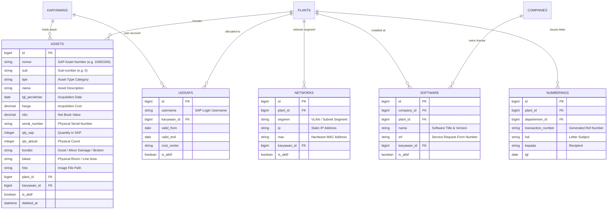

# 🏷️ Modul 03: Master Aset Tetap SAP & Infrastruktur IT

> **Status Modul:** `Production / Stable`  
> **Diperkenalkan Sejak:** `v0.1.0` (18 Juli 2024)  
> **Pembaruan Terakhir:** `v0.6.0` (20 Agustus 2026)  
> **Ruang Lingkup:** Register Fixed Assets SAP, Lisensi Perangkat Lunak, Alokasi IP Jaringan, Akun SAP User, dan Penomoran Surat

---

## 🕒 Jejak Evolusi Modul (Module Version History)

- **v0.1.0 (2024-07-18):**
  - Pembuatan tabel register aset utama `assets` (nomor aset SAP, sub-aset, harga perolehan, NBV / Net Book Value, lokasi, dan pengguna).
  - Pembuatan modul pendukung IT: `uidsaps` (akun SAP), `software` (lisensi software), `networks` (alokasi IP & MAC address), dan `numberings` (arsip penomoran surat otomatis).
- **v0.5.0 (2025-08-27):**
  - Penambahan kolom relasi `company_id` pada master software untuk membedakan kepemilikan lisensi antar anak perusahaan.
- **v0.6.0 (2026-08-20):**
  - Penambahan fitur cetak kartu aset fisik (4 kartu per lembar kertas A4) via DomPDF dan dropdown filter cepat tipe aset.

---

## 🎯 1. Ringkasan Bisnis & Use Case

Aset tetap perusahaan (mesin pabrik, komputer server, workstation, kendaraan operasional, dan peralatan jaringan) memiliki nilai kapitalisasi tinggi dan diaudit secara berkala. Modul ini bertujuan:

1. **Sinkronisasi Buku SAP (Fixed Assets Ledger):** Mencatat nomor aset resmi dari sistem SAP lengkap dengan sub-number, harga perolehan (*acquisition cost*), serta nilai buku neto (*Net Book Value / NBV*).
2. **Kesesuaian Fisik vs Sistem:** Membandingkan kuantitas buku SAP (`qty_sap`) dengan kuantitas fisik di lapangan (`qty_aktual`) beserta foto fisik dan lokasi penempatan.
3. **Pencatatan Infrastruktur IT Terpadu:**
   - **UID SAP:** Memetakan akun user SAP karyawan, masa berlaku akun, dan Cost Center terkait.
   - **Software:** Mendokumentasikan lisensi aplikasi komersial, tanggal perolehan, dan Service Request Form (SRF).
   - **Jaringan:** Mencegah konflik IP (*IP conflict*) pada jaringan lokal dengan mendata IP address, segmen VLAN, dan MAC address perangkat.
   - **Numbering:** Manajemen nomor surat/dokumen keluar agar terhindar dari nomor surat ganda (*duplicate numbering*).

---

## 🗄️ 2. Skema Basis Data & Relasi (ERD)

---

## 💻 3. Implementasi Model Eloquent & Fitur Kunci

### Model [`Asset`](file:///home/netcom/apps/app/Models/Asset.php)
- Relasi Plant: `belongsTo(Plant::class)`.
- Relasi Pemegang: `belongsTo(Karyawan::class)`.
- Soft Deletes: Menjamin jejak aset yang sudah dihapus/dilepas (*disposed*) tetap tersimpan untuk audit perpajakan.

### Model [`Numbering`](file:///home/netcom/apps/app/Models/Numbering.php)
- Mengotomasi penomoran surat resmi dengan struktur:
  $$\text{No Surat} = \frac{\text{Nomor Urut}}{\text{Kode Departemen}} / \text{Kode Plant} / \text{Bulan Romawi} / \text{Tahun}$$

---

## 🖥️ 4. Antarmuka Pengguna & Filament Resources

| Resource Class | Navigasi Panel | Fitur Utama |
| :--- | :--- | :--- |
| [`AssetResource.php`](file:///home/netcom/apps/app/Filament/Resources/AssetResource.php) | *Asset Group* | Pencarian cepat nomor SAP, kalkulasi NBV, upload foto unit, cetak kartu label A4 grid |
| [`UidsapResource.php`](file:///home/netcom/apps/app/Filament/Resources/UidsapResource.php) | *Master IT Group* | Audit lisensi user SAP aktif dan masa berlaku user account |
| [`SoftwareResource.php`](file:///home/netcom/apps/app/Filament/Resources/SoftwareResource.php) | *Master IT Group* | Registrasi lisensi software dan pembagian hak pakai antar pabrik |
| [`NetworkResource.php`](file:///home/netcom/apps/app/Filament/Resources/NetworkResource.php) | *Master IT Group* | Monitoring alokasi alamat IP statis untuk mesin server, printer, dan PC client |
| [`NumberingResource.php`](file:///home/netcom/apps/app/Filament/Resources/NumberingResource.php) | *Master Group* | Generator nomor surat dinamis dan pengarsipan surat keluar |

---

## 🛠️ 5. Troubleshooting & Best Practices

| Masalah yang Sering Muncul | Penyebab Teknis | Solusi / Cara Mengatasi |
| :--- | :--- | :--- |
| Duplicate IP address pada modul jaringan | Petugas menginputkan alamat IP yang sudah dialokasikan ke perangkat lain | Pastikan kolom `ip` pada form `NetworkResource` diverifikasi atau difilter per `plant_id`. |
| Nilai NBV aset bernilai 0 di laporan | Angka depresiasi tidak terisi saat migrasi data dari file Excel SAP | Periksa nilai kolom `nbv` dan `harga` saat proses impor massal melalui artisan command / seeder. |
| Foto aset tidak tampil di panel Filament | Symlink `public/storage` belum terpasang di server | Jalankan perintah terminal: `php artisan storage:link`. |
