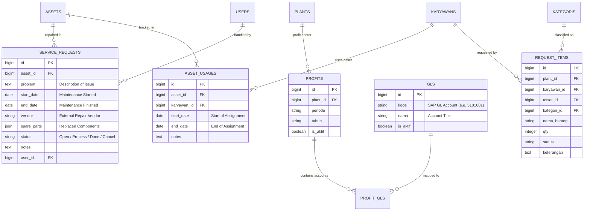

# 🔧 Modul 04: Finansial SAP, Service Request & Pengadaan IT

> **Status Modul:** `Production / Stable`  
> **Diperkenalkan Sejak:** `v0.2.0` (17 Oktober 2024)  
> **Pembaruan Terakhir:** `v0.2.0` (17 Oktober 2024)  
> **Ruang Lingkup:** Integrasi GL SAP, Profit Center, IT Helpdesk Service Request, Log Pemakaian Aset, Pengadaan Komponen

---

## 🕒 Jejak Evolusi Modul (Module Version History)

- **v0.2.0 (2024-10-17):**
  - Inisiasi modul akuntansi pembukuan SAP: tabel `gls` (General Ledger), `profits` (Profit Center), dan tabel pivot `profit_gls`.
  - Peluncuran portal tiket perbaikan perangkat keras `service_requests` dengan pencatatan vendor, spare part yang diganti, dan durasi pengerjaan.
  - Pembuatan log mutasi pemegang aset `asset_usages` untuk memantau kapan aset berpindah tangan antar karyawan.
  - Pembuatan portal pengadaan barang IT `request_items` dan standarisasi master `kategoris`.

---

## 🎯 1. Ringkasan Bisnis & Use Case

Ketika aset fisik mengalami malafungsi (*breakdown*) di pabrik, atau sebuah departemen membutuhkan suku cadang/komponen IT baru, perusahaan memerlukan pencatatan sistematis:

1. **Pemeliharaan & Servis Aset (`ServiceRequest`):** Mencatat kronologi kerusakan aset, vendor pihak ketiga yang ditunjuk untuk perbaikan, daftar spare parts yang diganti (disimpan dalam format JSON), serta tanggal mulai dan selesainya pengerjaan.
2. **Audit Perpindahan Pemakai (`AssetUsage`):** Menyimpan histori siapa saja karyawan yang pernah memegang unit aset tertentu dan berapa lama masa pakainya (*start_date* s/d *end_date*).
3. **Pengadaan Komponen Baru (`RequestItem`):** Memberikan akses bagi departemen untuk mengajukan permintaan barang operasional IT ke tim logistik/IT pusat.
4. **Alokasi Beban Biaya SAP (`GL & Profit Center`):** Memastikan biaya operasional dan suku cadang dapat dialokasikan ke akun buku besar (General Ledger) dan Profit Center plant yang tepat.

---

## 🗄️ 2. Skema Basis Data & Relasi (ERD)



---

## 💻 3. Implementasi Model Eloquent & Logika Bisnis

### Model [`ServiceRequest`](file:///home/netcom/apps/app/Models/ServiceRequest.php)
- Kolom `spare_parts` dikonfigurasi sebagai JSON Array cast:
```php
protected $casts = [
    'spare_parts' => 'array',
];
```
- Berelasi langsung ke [`Asset`](file:///home/netcom/apps/app/Models/Asset.php) dan [`User`](file:///home/netcom/apps/app/Models/User.php) teknisi yang menangani.

### Model [`AssetUsage`](file:///home/netcom/apps/app/Models/AssetUsage.php)
- Menyediakan riwayat kronologis pemegang unit aset (*custodianship history*). Berguna saat terjadi kerusakan fisik atau audit BPK/internal untuk melacak siapa penanggung jawab unit pada tanggal kejadian.

---

## 🖥️ 4. Antarmuka Pengguna & Filament Resources

| Resource Class | Navigasi Panel | Fitur Utama |
| :--- | :--- | :--- |
| [`ServiceRequestResource.php`](file:///home/netcom/apps/app/Filament/Resources/ServiceRequestResource.php) | *Transaksi Group* | Pilihan aset interaktif, input komponen spare parts dinamis, status pengerjaan tiket, ekspor Excel |
| [`AssetUsageResource.php`](file:///home/netcom/apps/app/Filament/Resources/AssetUsageResource.php) | *Asset Group* | Pencatatan tanggal penyerahan aset ke staf baru dan penarikan aset dari staf lama |
| [`RequestItemResource.php`](file:///home/netcom/apps/app/Filament/Resources/RequestItemResource.php) | *Transaksi Group* | Permohonan pembelian komponen/periferal IT baru oleh divisi operasional |
| [`KategoriResource.php`](file:///home/netcom/apps/app/Filament/Resources/KategoriResource.php) | *Master Group* | Pengelompokan jenis barang IT (Hardware, Consumable, Sparepart, Cable) |

---

## 🛠️ 5. Troubleshooting & Best Practices

| Masalah yang Sering Muncul | Penyebab Teknis | Solusi / Cara Mengatasi |
| :--- | :--- | :--- |
| Spare parts tidak tersimpan saat form di-submit | Array data JSON tidak ter-serialize dengan benar pada database MySQL versi lama | Pastikan field repeater form di `ServiceRequestResource` memiliki nama key yang konsisten dan terdaftar di `$fillable`. |
| Nilai estimasi perbaikan tidak masuk ke GL | Belum ada pemetaan antara akun GL dengan Profit Center plant bersangkutan | Lengkapi master data `ProfitGl` untuk plant tersebut sebelum memproses alokasi biaya. |
