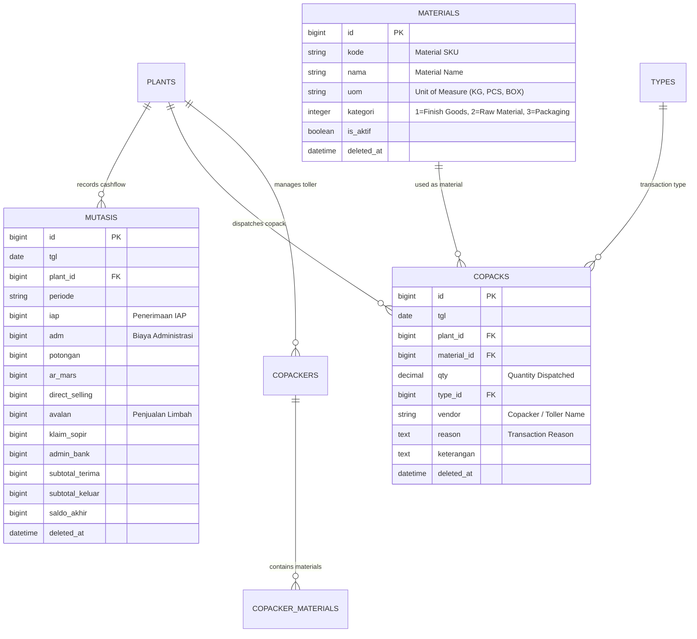

# 💰 Modul 05: Rekonsiliasi Kas Bank Plant & Manufaktur Maklon (Copack)

> **Status Modul:** `Production / Stable`  
> **Diperkenalkan Sejak:** `v0.3.0` (26 Februari 2025)  
> **Pembaruan Terakhir:** `v0.3.0` (26 Februari 2025)  
> **Ruang Lingkup:** Treasury Kas Plant, Rekonsiliasi Rekening Koran Bank, Aliran Material Maklon/Toll Manufacturing

---

## 🕒 Jejak Evolusi Modul (Module Version History)

- **v0.1.0 (2024-07-09):**
  - Desain skema awal tabel `materials` dan `copacks`.
- **v0.3.0 (2025-02-26):**
  - *Full Implementation:* Pembuatan tabel `mutasis` dengan kolom-kolom pos penerimaan/pengeluaran plant (IAP, ADM, Potongan, AR Mars, Direct Selling, Avalan, Klaim Sopir, Admin Bank, dsb).
  - Penambahan kolom subtotal dinamis dan kalkulasi saldo akhir otomatis.
  - Perluasan modul Maklon Copack: tabel `copackers`, `copacker_materials`, tabel pivot `material_plant`, dan penambahan kolom `reason` & `vendor`.

---

## 🎯 1. Ringkasan Bisnis & Use Case

Sistem mengakomodasi dua kebutuhan operasional pabrik yang sangat penting:

1. **Rekonsiliasi Kas Operasional Bank Pabrik (`Mutasi`):**
   - Setiap pabrik memiliki rekening bank operasional untuk transaksi harian.
   - Modul `Mutasi` mencatat pos-pos penerimaan (penjualan langsung, jaminan galon, limbah avalan, sewa depo) dan pos pengeluaran/potongan (klaim supir, biaya admin, pembayaran listrik).
   - Menghitung subtotal penerimaan vs pengeluaran untuk mencocokkan saldo buku dengan rekening koran bank (*bank reconciliation*).
2. **Manajemen Maklon / Toll Manufacturing (`Copack`):**
   - Perusahaan bekerja sama dengan pabrik maklon luar (*copacker*) untuk memproduksi atau mengemas produk tertentu.
   - Modul ini memantau pengiriman bahan baku (*raw material/packaging*), nomor dokumen jalan (No. Doc / Surat Jalan), nomor polisi truk ekspedisi, supplier, dan alasan mutasi barang maklon.

---

## 🗄️ 2. Skema Basis Data & Relasi (ERD)



---

## 💻 3. Implementasi Model Eloquent & Fitur Kunci

### Model [`Mutasi`](file:///home/netcom/apps/app/Models/Mutasi.php)
- Memiliki banyak kolom nominal finansial (tipe data `bigint`) untuk mendukung angka miliaran rupiah tanpa terjadi pembulatan presisi.
- Mengelompokkan transaksi per tanggal dan per `plant_id`.

### Model [`Material`](file:///home/netcom/apps/app/Models/Material.php)
- Memiliki Accessor untuk kategori material:
```php
public function getKategoriDeskripsiAttribute()
{
    switch ($this->kategori) {
        case 1: return 'Finish Goods';
        case 2: return 'Raw Material';
        case 3: return 'Packaging';
        default: return 'Lainnya';
    }
}
```

---

## 🖥️ 4. Antarmuka Pengguna & Filament Resources

| Resource Class | Navigasi Panel | Fitur Utama |
| :--- | :--- | :--- |
| [`MutasiResource.php`](file:///home/netcom/apps/app/Filament/Resources/MutasiResource.php) | *Treasury Group* | Formulir pencatatan kas multi-pos, filter periode bulan/tahun, ringkasan saldo kas bank per pabrik |
| [`CopackResource.php`](file:///home/netcom/apps/app/Filament/Resources/CopackResource.php) | *Operasional Group* | Tracking alur pengiriman bahan baku maklon, kuantitas material desimal presisi, alasan pengiriman |
| [`MaterialResource.php`](file:///home/netcom/apps/app/Filament/Resources/MaterialResource.php) | *Master Group* | Master kode SKU material, klasifikasi bahan baku/kemasan/FG, dan satuan UOM |
| [`TypeResource.php`](file:///home/netcom/apps/app/Filament/Resources/TypeResource.php) | *Master Group* | Tipe transaksi operasional maklon (Pengiriman, Retur, Scrap, Pemusnahan) |

---

## 🛠️ 5. Troubleshooting & Best Practices

| Masalah yang Sering Muncul | Penyebab Teknis | Solusi / Cara Mengatasi |
| :--- | :--- | :--- |
| Angka mutasi terpotong atau overflow | Kolom database bertipe `integer` standar (maksimum ~2.1 miliar) | Kolom `iap` dan nominal mutasi telah dimigrasi menjadi `bigint` pada migrasi `2025_04_24_160428_change_iap_to_bigint_in_mutasis_table.php`. |
| Material maklon tidak muncul di dropdown | Relasi mapping `material_plant` belum dibuat untuk plant yang dipilih | Pastikan material yang diinput sudah dihubungkan ke lokasi plant melalui tabel pivot atau master material aktif. |
