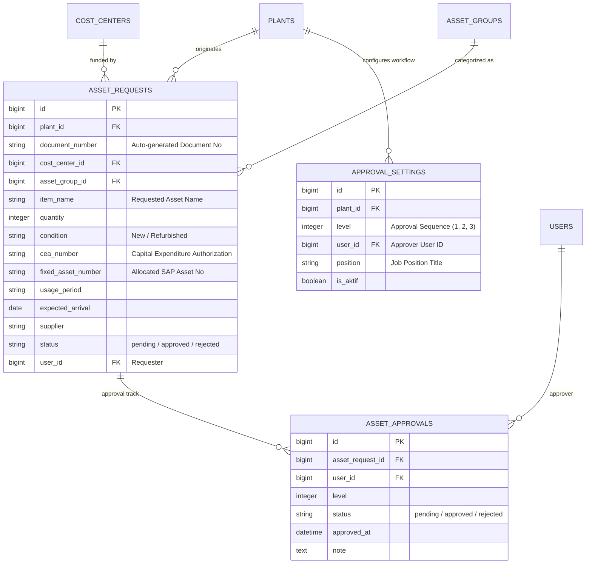
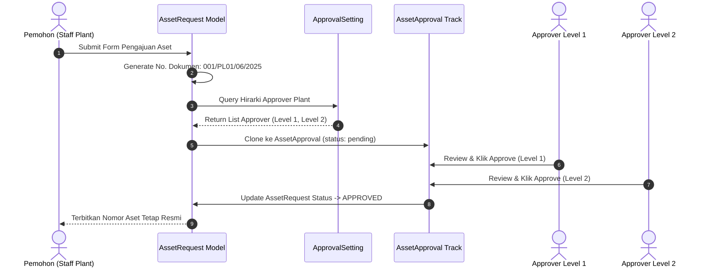

# 📑 Modul 06: Pengadaan Nomor Aset & Approval Engine v1

> **Status Modul:** `Production / Stable`  
> **Diperkenalkan Sejak:** `v0.4.0` (18 Juni 2025)  
> **Pembaruan Terakhir:** `v0.4.0` (18 Juni 2025)  
> **Ruang Lingkup:** Pengajuan Aset Baru (CAPEX), Engine Approval Bertingkat, Cost Center, Ekspor Formulir PDF

---

## 🕒 Jejak Evolusi Modul (Module Version History)

- **v0.4.0 (2025-06-18):**
  - Rilis modul pengajuan aset modal: `asset_requests`, `asset_approvals`, `approval_settings`, `cost_centers`, dan `asset_groups`.
  - Implementasi **Approval Workflow Engine v1**: pembuatan otomatis baris approval berjenjang (Level 1, Level 2, Level 3) saat pengajuan dibuat menggunakan model hook `static::created`.
  - Generator otomatis `document_number` berbasis urutan bulan, tahun, dan kode plant: `{urut}/{plantKode}/{month}/{year}`.
  - Integrasi ekspor formulir pengajuan resmi dalam format PDF via `barryvdh/laravel-dompdf`.

---

## 🎯 1. Ringkasan Bisnis & Use Case

Sebelum unit mesin, komputer server, atau armada baru dibeli oleh tim procurement dan didaftarkan ke modul Master Aset SAP, departemen terkait harus mengajukan permohonan nomor aset modal:

1. **Kelayakan Pembelian Aset (CAPEX Review):** Memastikan aset yang akan dibeli memiliki alokasi anggaran (*Cost Center*), kelompok aset yang sesuai (*Asset Group*), estimasi masa pakai (*usage period*), dan nomor justifikasi belanja modal (*CEA Number*).
2. **Otorisasi Berjenjang Multi-Plant:** Menjamin bahwa pengajuan diperiksa dan disetujui secara berurutan oleh pihak yang berwenang (misal: Level 1 = Supervisor / Dept Head, Level 2 = Plant Manager / Factory GM, Level 3 = Finance Controller).
3. **Penerbitan Dokumen Resmi:** Pengajuan yang telah disetujui menghasilkan nomor dokumen legal yang dapat dicetak menjadi lampiran Purchase Order (PO).

---

## 🗄️ 2. Skema Basis Data & Relasi (ERD)



---

## 💻 3. Implementasi Model Eloquent & Logika Approval

### Otomasi Nomor Dokumen ([`AssetRequest.php`](file:///home/netcom/apps/app/Models/AssetRequest.php))
Pada model hook `static::creating`, sistem menghitung urutan pengajuan di bulan berjalan per pabrik:
```php
static::creating(function ($assetRequest) {
    $month = now()->format('m');
    $year = now()->format('Y');
    $plant = Plant::find($assetRequest->plant_id);
    $plantKode = $plant?->kode ?? 'XXX';

    $count = self::whereMonth('created_at', now()->month)
                ->whereYear('created_at', now()->year)
                ->where('plant_id', $assetRequest->plant_id)
                ->count();

    $urut = str_pad($count + 1, 3, '0', STR_PAD_LEFT);
    $assetRequest->document_number = "{$urut}/{$plantKode}/{$month}/{$year}";
});
```

### Otomasi Baris Persetujuan (*Approval Pipeline Generation*)
Pada model hook `static::created`, sistem secara otomatis menyalin aturan persetujuan dari `ApprovalSetting` plant terkait ke tabel jejak `AssetApproval`:
```php
static::created(function ($assetRequest) {
    $settings = ApprovalSetting::where('plant_id', $assetRequest->plant_id)
        ->orderBy('level')
        ->get();

    foreach ($settings as $setting) {
        AssetApproval::create([
            'asset_request_id' => $assetRequest->id,
            'user_id' => $setting->user_id,
            'level' => $setting->level,
            'status' => 'pending',
        ]);
    }

    $assetRequest->update(['status' => 'pending']);
});
```

---

## 🖥️ 4. Antarmuka Pengguna & Filament Resources

| Resource Class | Navigasi Panel | Fitur Utama |
| :--- | :--- | :--- |
| [`AssetRequestResource.php`](file:///home/netcom/apps/app/Filament/Resources/AssetRequestResource.php) | *Asset Request Group* | Formulir pengajuan nomor aset, status verifikasi per level, aksi persetujuan (*Approve/Reject*), cetak PDF |
| [`ApprovalSettingResource.php`](file:///home/netcom/apps/app/Filament/Resources/ApprovalSettingResource.php) | *Setting Group* | Pengaturan matriks hirarki approver per lokasi pabrik (Level 1, Level 2, Level 3) |
| [`CostCenterResource.php`](file:///home/netcom/apps/app/Filament/Resources/CostCenterResource.php) | *Master Group* | Master kode dan deskripsi Cost Center pembebanan anggaran |

---

## 🔄 5. Alur Kerja Pengajuan & Approval



---

## 🛠️ 6. Troubleshooting & Best Practices

| Masalah yang Sering Muncul | Penyebab Teknis | Solusi / Cara Mengatasi |
| :--- | :--- | :--- |
| Dokumen pengajuan baru tidak memiliki daftar approver | Pengaturan `ApprovalSetting` untuk plant tersebut belum dikonfigurasi | Buka menu `ApprovalSettingResource`, buat minimal satu urutan approver (Level 1) untuk plant bersangkutan sebelum user mengajukan aset. |
| Nomor dokumen terduplikasi | Dua transaksi diajukan secara bersamaan (*race condition*) dalam detik yang sama | Sistem menggunakan filter bulan dan plant. Untuk volume tinggi, disarankan menggunakan database locking atau nomor serial sequence terdedikasi. |
