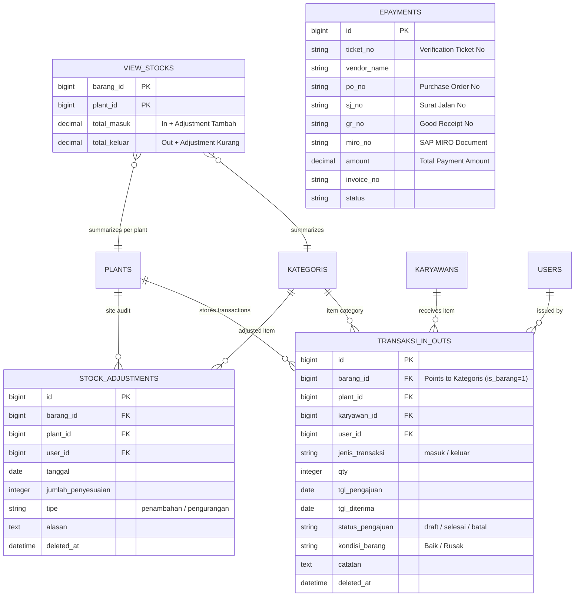

# 📦 Modul 07: Manajemen Stok Gudang IT & E-Payment Voucher

> **Status Modul:** `Production / Stable`  
> **Diperkenalkan Sejak:** `v0.5.0` (27 Agustus 2025)  
> **Pembaruan Terakhir:** `v0.5.0` (27 Agustus 2025)  
> **Ruang Lingkup:** Persediaan Gudang (Sparepart/Consumable), Transaksi In/Out, Stock Opname Fisik, Database View Saldo Real-time, E-Payment Invoice Voucher

---

## 🕒 Jejak Evolusi Modul (Module Version History)

- **v0.5.0 (2025-08-27):**
  - Rilis perdana modul pergudangan IT: tabel `transaksi_in_outs` untuk pencatatan penerimaan dan pengeluaran barang.
  - Pembuatan fitur stock opname `stock_adjustments` untuk koreksi selisih fisik vs sistem.
  - Implementasi MySQL Database View `view_stocks` untuk kalkulasi saldo berjalan secara real-time.
  - Penerapan isolasi data multi-cabang dengan menambahkan kolom `plant_id` pada transaksi in/out, adjustment, dan view stock.
  - Rilis modul verifikasi pembayaran vendor `epayments` (pencocokan PO, Surat Jalan, Good Receipt, MIRO SAP, dan Invoice).

---

## 🎯 1. Ringkasan Bisnis & Use Case

Departemen IT dan logistik pabrik mengelola banyak barang consumable (tinta printer, kabel LAN, SSD, RAM, mouse) yang keluar masuk setiap hari. Modul ini bertujuan:

1. **Pengendalian Barang Masuk & Keluar (`TransaksiInOut`):** Setiap barang yang masuk dari vendor atau diserahkan ke pengguna dicatat kuantitasnya, kondisi fisiknya, serta persetujuan serah terima.
2. **Koreksi Stock Opname (`StockAdjustment`):** Saat audit fisik bulanan menemukan selisih antara stok sistem dengan fisik di rak gudang, admin dapat melakukan adjustment penambahan (*surplus*) atau pengurangan (*damaged/lost*) disertai alasan audit.
3. **Monitoring Saldo Real-Time (`ViewStock`):** Menampilkan sisa persediaan di masing-masing pabrik tanpa perlu menghitung query agregat lambat di sisi aplikasi.
4. **Verifikasi E-Payment Vendor (`Epayment`):** Portal rekonsiliasi faktur tagihan supplier dengan dokumen logistik (Purchase Order / PO, Surat Jalan / SJ, Good Receipt / GR, dan No. MIRO SAP) sebelum pembayaran dieksekusi.

---

## 🗄️ 2. Skema Basis Data & Database View



---

## 💻 3. Implementasi MySQL View & Perhitungan Stok

Saldo stok tidak disimpan sebagai kolom statis untuk menghindari inkonsistensi data akibat pembatalan atau revisi transaksi. Sebaliknya, saldo dihitung secara reaktif oleh database server melalui view [`view_stocks`](file:///home/netcom/apps/database/migrations/2025_07_25_150315_update_view_stocks_with_plant.php):

$$\text{Total Masuk} = \sum(\text{Transaksi Masuk}) + \sum(\text{Adjustment Penambahan})$$

$$\text{Total Keluar} = \sum(\text{Transaksi Keluar}) + \sum(\text{Adjustment Pengurangan})$$

$$\text{Stok Tersedia} = \text{Total Masuk} - \text{Total Keluar}$$

Cuplikan DDL View:
```sql
CREATE OR REPLACE VIEW view_stocks AS
SELECT
    t.barang_id,
    t.plant_id,
    COALESCE(t_masuk, 0) + COALESCE(sa_tambah, 0) AS total_masuk,
    COALESCE(t_keluar, 0) + COALESCE(sa_kurang, 0) AS total_keluar
FROM (
    SELECT barang_id, plant_id FROM transaksi_in_outs
    UNION
    SELECT barang_id, plant_id FROM stock_adjustments
) AS t
LEFT JOIN (
    SELECT barang_id, plant_id, SUM(qty) AS t_masuk
    FROM transaksi_in_outs
    WHERE jenis_transaksi = 'masuk' AND status_pengajuan = 'selesai'
    GROUP BY barang_id, plant_id
) AS tm ON tm.barang_id = t.barang_id AND tm.plant_id = t.plant_id
LEFT JOIN (
    SELECT barang_id, plant_id, SUM(qty) AS t_keluar
    FROM transaksi_in_outs
    WHERE jenis_transaksi = 'keluar' AND status_pengajuan = 'selesai'
    GROUP BY barang_id, plant_id
) AS tk ON tk.barang_id = t.barang_id AND tk.plant_id = t.plant_id
...
```

---

## 🖥️ 4. Antarmuka Pengguna & Filament Resources

| Resource Class | Navigasi Panel | Fitur Utama |
| :--- | :--- | :--- |
| [`TransaksiInOutResource.php`](file:///home/netcom/apps/app/Filament/Resources/TransaksiInOutResource.php) | *Stock Group* | Input transaksi mutasi gudang masuk/keluar, penerima barang, status verifikasi |
| [`StockAdjustmentResource.php`](file:///home/netcom/apps/app/Filament/Resources/StockAdjustmentResource.php) | *Stock Group* | Form stock opname untuk menyeimbangkan stok fisik dengan sistem |
| [`ViewStockResource.php`](file:///home/netcom/apps/app/Filament/Resources/ViewStockResource.php) | *Stock Group* | Dashboard rekapitulasi persediaan real-time dengan filter plant dan kategori barang |
| [`EpaymentResource.php`](file:///home/netcom/apps/app/Filament/Resources/EpaymentResource.php) | *Finance Group* | Matching dokumen faktur tagihan supplier (PO, GR, MIRO, Invoice) |

---

## 🛠️ 5. Troubleshooting & Best Practices

| Masalah yang Sering Muncul | Penyebab Teknis | Solusi / Cara Mengatasi |
| :--- | :--- | :--- |
| Saldo di `ViewStock` tidak bertambah setelah barang masuk | Status pengajuan pada `TransaksiInOut` masih berstatus `draft` | Hanya transaksi dengan `status_pengajuan = 'selesai'` yang dihitung oleh view stok. Pastikan staf gudang menyelesaikan transaksi. |
| Error `Primary key null` saat membuka halaman view stock | Model `ViewStock` membaca MySQL View yang tidak memiliki kolom auto-increment PK tunggal | Gunakan `protected $primaryKey = null;` dan `public $incrementing = false;` pada Model, serta definisikan composite route key `getRouteKey()`. |
