# 🏷️ Modul 08: Pelabelan Fisik Aset (Kartu Aset 4-Up) & Notifikasi Operasional

> **Status Modul:** `Production / Stable`  
> **Diperkenalkan Sejak:** `v0.6.0` (20 Agustus 2026)  
> **Pembaruan Terakhir:** `v0.6.0` (20 Agustus 2026)  
> **Ruang Lingkup:** Standarisasi Label Aset Fisik, Layouting DomPDF Presisi A4, Custom Bulk Action, Optimasi Email Notifikasi

---

## 🕒 Jejak Evolusi Modul (Module Version History)

- **v0.6.0 (2026-08-20):**
  - Rilis fitur cetak kartu fisik aset: template Blade [`resources/views/pdf/asset-cards.blade.php`](file:///home/netcom/apps/resources/views/pdf/asset-cards.blade.php) berukuran proporsional (tepat 4 kartu per lembar kertas A4) dengan proteksi pemisah halaman otomatis (`page-break-inside: avoid`).
  - Penambahan bulk action **Export PDF** pada `AssetResource` untuk mengunduh ratusan kartu aset sekaligus dalam satu berkas PDF.
  - Penambahan filter cepat dropdown tipe aset (`tipe`) pada tabel master aset.
  - Optimasi notifikasi email peminjaman: perbaikan *eager loading* relasi (`plant.company`, `karyawan`, `user`) untuk mencegah overhead kueri.

---

## 🎯 1. Ringkasan Bisnis & Use Case

Label stiker pada mesin pabrik, komputer, atau genset sering kali cepat pudar, berukuran tidak seragam, atau sulit dibaca saat audit fisik tahunan. Modul ini bertujuan:

1. **Standarisasi Kartu Identifikasi Fisik:** Menghasilkan kartu label aset berformat standar korporat yang siap dicetak pada kertas A4 (atau kertas stiker vinil), digunting, dan ditempelkan pada unit fisik.
2. **Kapasitas 4 Kartu Per Halaman:** Memaksimalkan efisiensi kertas dengan mengunci layout menjadi tepat 4 kartu per halaman A4 tanpa risiko terpotong di tepi kertas (*margin overflow*).
3. **Informasi Teknis Lengkap:** Setiap kartu memuat:
   - Nomor Aset SAP & Sub-Number
   - Serial Number pabrikan
   - Nama & Deskripsi unit
   - Tanggal Perolehan & Lokasi Pabrik (Plant)
   - Nama Pengguna / Penanggung Jawab (*Custodian*)
   - Kode Entitas Perusahaan (Company)

---

## 🖨️ 2. Arsitektur Layout DomPDF (4-Up Card Grid)

Rendering PDF menggunakan library `barryvdh/laravel-dompdf` (berbasis pustaka CPDF). Untuk menjamin kartu tidak terpotong saat transisi halaman (*page break*), diterapkan styling CSS murni:

```html
@page {
    size: A4 portrait;
    margin: 10mm;
}

/* Mengunci tinggi kartu agar maksimal 4 kartu per halaman A4 */
.card {
    border: 1px solid #1a365d;
    border-radius: 4px;
    margin-bottom: 10px;
    padding: 8px;
    background: #ffffff;
    page-break-inside: avoid; /* Mencegah kartu terbelah dua */
}

.card-header {
    background-color: #1a365d;
    color: #ffffff;
    padding: 5px 8px;
    font-weight: bold;
}
```

---

## 💻 3. Implementasi Bulk Action di Filament

Pada [`AssetResource.php`](file:///home/netcom/apps/app/Filament/Resources/AssetResource.php), aksi massal dikonfigurasi untuk mengekstrak seluruh rekaman yang dipilih user:

```php
use Barryvdh\DomPDF\Facade\Pdf;

BulkAction::make('export_pdf')
    ->label('Export PDF (Kartu Aset)')
    ->icon('heroicon-o-document-arrow-down')
    ->color('danger')
    ->action(function ($records) {
        // Eager loading relasi agar kueri sangat cepat
        $assets = $records->load(['plant.company', 'karyawan', 'user']);

        // Load Blade view dengan orientasi A4 Portrait
        $pdf = Pdf::loadView('pdf.asset-cards', compact('assets'))
            ->setPaper('a4', 'portrait');

        $fileName = 'Export-Assets-' . now()->format('Y-m-d_His') . '.pdf';

        // Stream download langsung ke browser
        return response()->streamDownload(function () use ($pdf) {
            echo $pdf->stream();
        }, $fileName);
    });
```

---

## 🔄 4. Alur Kerja Cetak Kartu Aset

```mermaid
flowchart LR
    A[Buka Menu AssetResource] --> B[Filter Plant / Tipe Aset]
    B --> C[Centang Checklist Baris Aset yang Ingin Dicetak]
    C --> D[Pilih Bulk Action: Export PDF]
    D --> E[Eager Loading Relasi Plant, Karyawan, User]
    E --> F[Render Template `pdf.asset-cards`]
    F --> G[Download File PDF: 4 Kartu / Lembar A4]
    G --> H[Cetak Fisik & Tempel ke Unit Aset]
```



---

## 🛠️ 5. Troubleshooting & Best Practices

| Masalah yang Sering Muncul | Penyebab Teknis | Solusi / Cara Mengatasi |
| :--- | :--- | :--- |
| Error `Class "App\Filament\Resources\Pdf" not found` | Namespace class PDF terpanggil lokal tanpa import Facade | Gunakan `use Barryvdh\DomPDF\Facade\Pdf;` di baris atas file resource. |
| Kartu ke-4 bergeser ke halaman berikutnya | Margin halaman atau padding CSS terlalu besar | Pertahankan ukuran `@page { margin: 10mm; }` dan tinggi kartu `.card` sekitar `180px - 200px`. |
| Download PDF timeout saat memilih lebih dari 500 aset | Proses kompilasi CPDF memakan memori tinggi di server | Lakukan batching atau batasi pemilihan maksimal 100-200 aset per download bulk action. |
