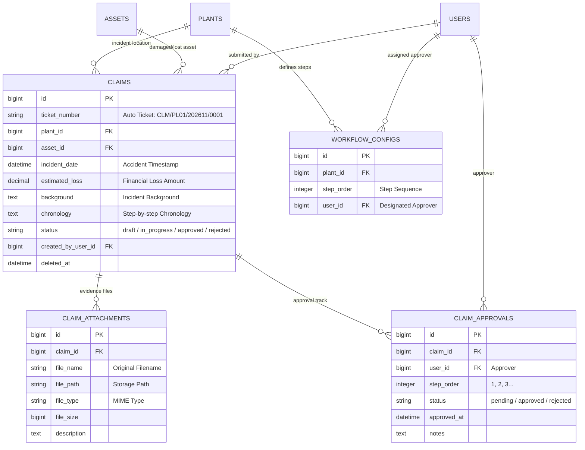
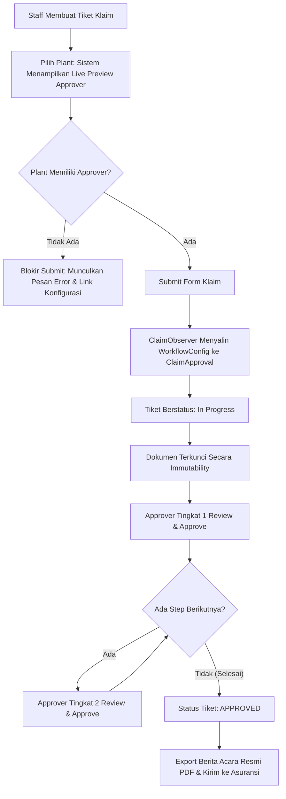

# 🛡️ Modul 09: Klaim Insiden Aset & Data Governance

> **Status Modul:** `Production / Baseline v1.0.0`  
> **Diperkenalkan Sejak:** `v1.0.0` (18 November 2026)  
> **Pembaruan Terakhir:** `v1.0.0` (18 November 2026)  
> **Ruang Lingkup:** Insiden Kerusakan/Kehilangan Aset, Klaim Asuransi, Approval Dinamis Multi-Level, Live Preview, Proteksi Audit Trail, Ekspor PDF BAP & Excel

---

## 🕒 Jejak Evolusi Modul (Module Version History)

- **v1.0.0 (2026-11-18):**
  - *Initial Production Release:* Peluncuran penuh modul klaim insiden aset untuk proses reimbursement asuransi (`ClaimResource`).
  - Implementasi **Dynamic Approval Engine v2**: `ClaimObserver` yang otomatis menduplikasi urutan approver dari tabel `workflow_configs` ke tabel `claim_approvals` per lokasi plant.
  - Fitur **Live Approval Preview**: evaluasi reaktif daftar nama approver secara real-time saat plant dipilih pada formulir pembuatan tiket klaim baru.
  - Aturan validasi pencegahan pembuatan tiket jika alur approval plant belum dikonfigurasi.
  - Penerapan metode terenkapsulasi pada model `Claim`: `approve()`, `reject()`, `currentStepOrder()`, `isUserCurrentApprover()`, dan `canBeEdited()`.
  - Fitur **Immutability Data Transaksi**: penonaktifan tombol edit dan proteksi akses URL (`403 Forbidden`) begitu ada approver yang memberikan persetujuan.
  - Proteksi berkas lampiran fisik pada level Form Repeater dan Model Hook `static::deleting`.
  - Prioritas tampilan kueri: dokumen yang sedang menunggu giliran approval dari pengguna yang sedang login otomatis tampil di baris teratas.
  - Ekspor dokumen resmi berstandar arsip fisik Berita Acara (PDF A4 Portrait) dengan stempel pengesahan digital dan rekapitulasi data Excel via `ClaimExport`.

---

## 🎯 1. Ringkasan Bisnis & Use Case

Ketika aset fisik perusahaan mengalami kerusakan parah akibat kecelakaan kerja, bencana, atau hilang akibat pencurian, perusahaan memerlukan proses investigasi formal untuk klaim ganti rugi asuransi:

1. **Pencatatan Insiden Terperinci:** Mencatat tanggal kejadian, kronologi lengkap, latar belakang, serta estimasi kerugian finansial.
2. **Koleksi Bukti Fisik Valid:** Mengunggah foto kondisi kerusakan fisik, Berita Acara Pemeriksaan (BAP) kepolisian/internal, dan faktur perbaikan sebagai bukti klaim asuransi yang sah.
3. **Persetujuan Bertingkat Otomatis:** Otorisasi harus melalui pimpinan unit kerja (Supervisor $\rightarrow$ Factory Manager $\rightarrow$ Asuransi/Direksi) sesuai hierarki pabrik terkait.
4. **Integritas & Kepatuhan Hukum:** Setelah diverifikasi oleh salah satu pimpinan, dokumen tidak boleh diubah atau dihapus oleh pembuat tiket untuk mencegah manipulasi data klaim (*anti-fraud*).

---

## 🗄️ 2. Skema Basis Data & Relasi (ERD)



---

## 💻 3. Implementasi Model Eloquent & Metode Enkapsulasi

Logika verifikasi dan persetujuan dienkapsulasi langsung di dalam Model [`Claim.php`](file:///home/netcom/apps/app/Models/Claim.php):

```php
// Menentukan nomor urut approval yang sedang aktif menunggu tindakan
public function currentStepOrder(): ?int
{
    return $this->approvals()
        ->where('status', 'pending')
        ->orderBy('step_order', 'asc')
        ->value('step_order');
}

// Memverifikasi apakah user yang login berhak melakukan approval pada giliran saat ini
public function isUserCurrentApprover(User $user): bool
{
    $currentStep = $this->currentStepOrder();
    if ($currentStep === null) {
        return false;
    }

    return $this->approvals()
        ->where('status', 'pending')
        ->where('step_order', $currentStep)
        ->where('user_id', $user->id)
        ->exists();
}

// Menjalankan persetujuan dan melanjutkan status ke langkah berikutnya
public function approve(User $user, ?string $notes = null): void
{
    $currentStep = $this->currentStepOrder();
    $approval = $this->approvals()
        ->where('status', 'pending')
        ->where('step_order', $currentStep)
        ->where('user_id', $user->id)
        ->firstOrFail();

    $approval->update([
        'status' => 'approved',
        'approved_at' => now(),
        'notes' => $notes,
    ]);

    // Jika seluruh urutan step sudah disetujui, ubah status utama klaim
    if (!$this->approvals()->where('status', 'pending')->exists()) {
        $this->update(['status' => 'approved']);
    } else {
        $this->update(['status' => 'in_progress']);
    }
}

// Mengunci dokumen jika approval sudah dimulai
public function canBeEdited(): bool
{
    if (in_array($this->status, ['approved', 'rejected'])) {
        return false;
    }
    // Jika ada salah satu approver yang sudah approve/reject, form dikunci permanen
    return !$this->approvals()->whereIn('status', ['approved', 'rejected'])->exists();
}
```

---

## 🖥️ 4. Antarmuka Pengguna & Fitur Unggulan Filament

| Fitur | Implementasi Teknis | Keuntungan Bisnis |
| :--- | :--- | :--- |
| **Live Approval Preview** | Form `Select::make('plant_id')->live()->afterStateUpdated(...)` membaca tabel `WorkflowConfig` | Pembuat klaim langsung mengetahui siapa saja pejabat yang akan memverifikasi tiketnya sebelum dokumen disimpan. |
| **Proteksi URL Edit** | Validasi `authorize('update')` di `EditClaim.php` memanggil `$this->getRecord()->canBeEdited()` | Pengguna tidak dapat memanipulasi parameter URL browser untuk mengubah dokumen yang sedang di-review. |
| **Prioritas Baris Kueri** | `getEloquentQuery()` memprioritaskan dokumen dengan `pending_for_me` di posisi paling atas | Approver dapat langsung melihat pekerjaan prioritas tanpa harus mencari manual di halaman tabel. |
| **Thumbnail & Tab Baru** | Komponen custom HTML view di kolom tabel dengan efek CSS zoom dan badge file | Mempercepat verifikasi bukti fisik tanpa harus membuka satu per satu halaman edit klaim. |
| **Cetak BAP Resmi (PDF)** | Template [`claim-document.blade.php`](file:///home/netcom/apps/resources/views/pdf/claim-document.blade.php) berorientasi A4 Portrait | Menghasilkan berkas cetak fisik formal lengkap dengan stempel digital untuk klaim ke pihak asuransi. |
| **Rekapitulasi Excel** | Class [`ClaimExport.php`](file:///home/netcom/apps/app/Exports/ClaimExport.php) dengan styling Auto-Size | Memudahkan tim Accounting menganalisis total kerugian finansial per periode. |

---

## 🔄 5. Alur Kerja Klaim & Approval Dinamis



---

## 🛠️ 6. Troubleshooting & Best Practices

| Masalah yang Sering Muncul | Penyebab Teknis | Solusi / Cara Mengatasi |
| :--- | :--- | :--- |
| Form pembuatan tiket klaim ditolak saat simpan | Plant yang dipilih belum memiliki konfigurasi approver di tabel `workflow_configs` | Buka menu **Workflow Config**, tambahkan urutan user approver untuk plant tersebut. |
| Tombol Edit tidak muncul di baris tabel | Dokumen klaim sudah disetujui minimal oleh satu level approver | Ini adalah fitur keamanan sistem (*by design*). Dokumen yang sudah disetujui tidak boleh diubah isinya. |
| Lampiran PDF / Gambar tidak terbuka saat diklik | Symlink direktori storage terputus | Jalankan perintah terminal: `php artisan storage:link`. |
| Format angka estimasi kerugian tampil dengan `.00` | Format number format lama belum disesuaikan | Sistem sudah menggunakan `number_format($claim->estimated_loss, 0, ',', '.')` untuk menghasilkan format bersih tanpa desimal (contoh: `Rp 2.000.000`). |
